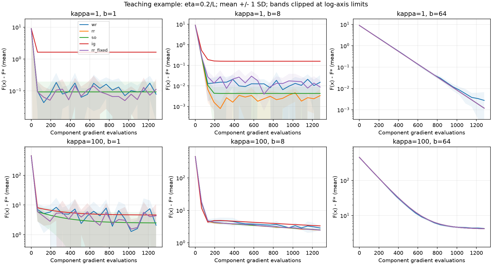
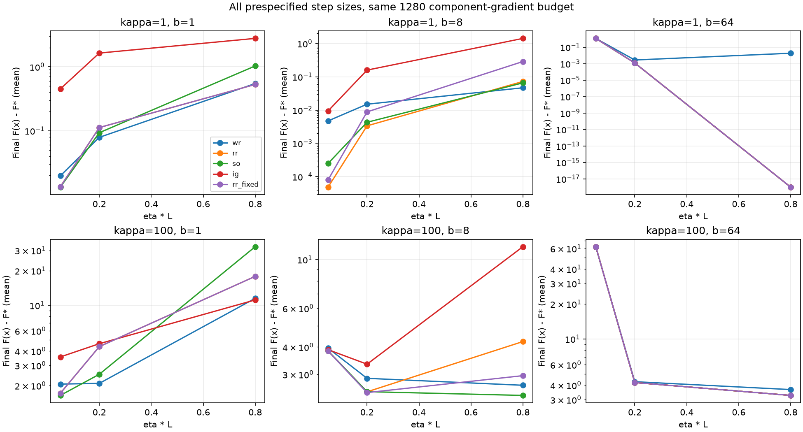

# v1_sampling_quadratic · 教学实验报告

**结论：采样与梯度实现的基础核验通过；结果展示了 batch、步长与顺序的共同影响，不构成任何论文的正式复现。**

## 配置与证据

固定配置见 [evaluation.md](../../experiment/evaluation.md)，机器可读输出见 [metrics.json](../../experiment/v1_sampling_quadratic/metrics.json)；全部 900 条轨迹见 [trajectories.json](../../experiment/v1_sampling_quadratic/trajectories.json)。

共同 Hessian 二次目标，64 个分量，2 维，数据种子 20261117；$\kappa=1,100$；$b=1,8,64$；$\eta\kappa=0.05,0.2,0.8$；20 个 epoch；采样种子 0–9。每种配置消耗 1280 次分量梯度，更新次数分别为 1280、160、20。

通过的检查：解析梯度与数值差分最大误差 $3.22\times10^{-11}$ 以下；full-batch 无放回方法与显式 GD 差异 $4.45\times10^{-16}$ 以下；有限总体方差恒等式的穷举误差 $8.89\times10^{-16}$ 以下；两样本例子、SO 排列复用与每轮样本覆盖均通过。900 条轨迹均有限。

## 固定展示步长下的结果

以下统一取 $\eta\kappa=0.2$，指标为第 20 轮末 $F(x)-F_\star$ 的 10 种子均值。全部候选步长和标准差保留在 JSON，下面不是挑出的最优配置。

| $\kappa$ | $b$ | WR | RR | SO | IG | 固定分批 RR |
|---|---|---|---|---|---|---|
| 1 | 1 | 0.078883 | 0.112259 | 0.093209 | 1.640743 | 0.112259 |
| 1 | 8 | 0.015010 | 0.003360 | 0.004301 | 0.158629 | 0.008816 |
| 1 | 64 | 0.002759 | 0.001196 | 0.001196 | 0.001196 | 0.001196 |
| 100 | 1 | 2.090745 | 4.368514 | 2.509395 | 4.632408 | 4.368514 |
| 100 | 8 | 2.878902 | 2.498741 | 2.502839 | 3.339592 | 2.478403 |
| 100 | 64 | 4.282755 | 4.213506 | 4.213506 | 4.213506 | 4.213506 |

## 如何解释

- 这组有限种子下，RR 并非每个 batch / 步长都比 WR 好。不能据此宣称理论被推翻，定理假设、输出和最坏情形口径必须一致。
- $b=1$ 时 RR 与固定分批 RR 等价；$b=64$ 时四种无放回方法都退化为 GD，曲线重合符合预期。
- `wr` 的一批由独立有放回样本组成，$b=64$ 仍有重复，所以不等于 full-batch GD。
- IG 的输入按中心第一坐标排序，造成顺序效应；不能把这一配置的劣势当作所有数据顺序的性质。
- 病态目标在相同小步长下，full-batch 每个 epoch 只有一次更新，慢方向下降有限；相同 epoch 与相同更新次数不等价。
- 所有配置同时保存平均参数的误差与平均损失，不能相互替换。这里只有一个合成数据实例，10 个种子只改变采样，不代表跨数据集统计。

## 可重复性和显示修正

`metrics.json` 保存实际运行时 Python / NumPy / Matplotlib 版本、数据哈希和脚本哈希；[runner_snapshot.py](../../experiment/v1_sampling_quadratic/runner_snapshot.py) 保留实际运行脚本。之后只调整了对数图的显示范围，避免均值减标准差为负时把纵轴拉到 $10^{-18}$，没有改动轨迹、统计或筛选数据。原始显示保留为 `convergence_sd_initial.png`，新图由 `experiment/replot_demo.py` 从已保存数据生成。

阴影是均值 ± 1 个样本标准差，不是置信区间；负下界在对数坐标显示范围处截断。该图只用于基础现象观察。

## 未完成

尚未运行 P03 / P05 作者代码、复现 P07 动态公式、测试非共同 Hessian、实数据或非凸网络；不能据此估计论文收敛阶或提出已验证创新。
